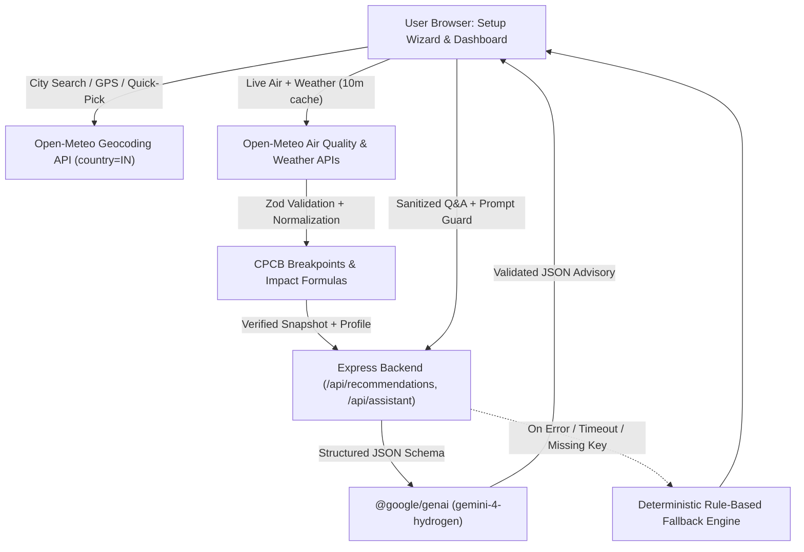

# VayuSaathi — Urban Air Quality Assistant

**VayuSaathi** is a GenAI-powered urban air quality assistant built for Indian families and communities navigating severe winter smog and urban air pollution. Rather than acting as a passive AQI dashboard or generic chatbot, VayuSaathi translates live environmental telemetry into personalized, explainable daily routines, indoor protection steps, and low-emission alternatives tailored to each household's location, members, home setup, budget, and commute.

---

## Problem & Approach

Air pollution advice often fails Indian households because it is either:
- **Generic** ("avoid outdoor activity") without accounting for school schedules, 60+ seniors, outdoor workers, or budget constraints, or
- **Opaque**, lacking *why*, *when*, *cost*, *limitations*, or quantifiable impact.

VayuSaathi solves this with a strict separation of responsibilities:
1. **Verified Live Telemetry Only**: Air quality and weather readings come exclusively from live Open-Meteo APIs (never hardcoded, cached past 10 minutes without notice, or invented by an LLM).
2. **Deterministic Math & Indian Standards**: Indian CPCB categories (estimated from model PM2.5/PM10 breakpoints), hourly cleanest/worst 2-hour windows, CADR purifier sizing, exposure reductions, and CO2 savings are computed deterministically with transparent formulas visible to the user.
3. **Grounded GenAI Interpretation + Safe Fallback**: Gemini (`gemini-4-hydrogen` via `@google/genai` on the Express server) receives only verified numbers, pre-computed impact figures, and the household profile to write structured, bilingual (English / Hindi) guidance. If Gemini fails or times out, a deterministic rule-based fallback engine produces complete, profile-aware guidance and notifies the user clearly.

---

## Architecture Diagram



---

## Data Sources

- **Air Quality**: `https://air-quality-api.open-meteo.com/v1/air-quality` (`pm2_5`, `pm10`, `us_aqi`, `nitrogen_dioxide`, `ozone`, `sulphur_dioxide`, `carbon_monoxide`, `timezone=auto`, 48-hour forecast).
- **City Search (India)**: `https://geocoding-api.open-meteo.com/v1/search` (filtered strictly to `country_code === 'IN'`).
- **Weather**: `https://api.open-meteo.com/v1/forecast` (`temperature_2m`, `relative_humidity_2m`, `wind_speed_10m`).
- **Indian CPCB Category**: Computed client-side from live PM2.5 and PM10 values using CPCB 24-hour breakpoints (`0–30 Good`, `31–60 Satisfactory`, `61–90 Moderate`, `91–120 Poor`, `121–250 Very Poor`, `250+ Severe` for PM2.5; `0–50`, `51–100`, `101–250`, `251–350`, `351–430`, `430+` for PM10) and explicitly labeled **"Estimated from model PM data"**.

Every air-quality number displays the data source name, observation timestamp, and live freshness indicator (`updated X min ago`).

---

## How AI Is Used vs. Rule-Based Logic

| Layer | Responsibility |
| --- | --- |
| **Deterministic Code (`cpcb.ts`, `impactFormulas.ts`, `airQualityService.ts`)** | Fetches & validates live Open-Meteo data, computes Indian CPCB sub-indices, identifies cleanest & worst 2-hour forecast windows, calculates CO2 savings, CADR sizing, and What-If exposure math. |
| **Gemini (`server.ts` -> `gemini-4-hydrogen`)** | Interprets the verified live telemetry, precomputed formula figures, and household profile to generate tailored Top 3 Actions, 5-part Daily Planner, Low-Emission Alternatives, Indoor & Family guidance, and contextual Q&A responses in English or Hindi using strict `responseSchema` JSON output. |
| **Rule-Based Fallback (`fallbackEngine.ts`)** | Activates automatically if Gemini is unavailable, errors, or times out, producing full schema-compliant, profile-aware advice and notifying the user that **Basic Rule-Based Mode** is active. |

---

## Impact Formulas (Shown in UI Expanders)

1. **Commute CO2 Saved per Trip**:
   `CO2_saved = (EF_from - EF_to) * oneWayDistanceKm`
   Using India passenger emission factors (`kg CO2e/pkm`): Car `0.171`, Carpool (2.5 occupancy) `0.0684`, Two-wheeler `0.058`, City Bus `0.042`, Metro `0.025`, Walk/WFH `0`.
2. **Commute Personal Exposure Change**:
   Compares relative roadside PM2.5 intake factors (`two_wheeler: 1.25`, `walk: 1.05`, `bus: 0.85`, `car_ac: 0.65`, `metro: 0.45`, `wfh: 0.35`).
3. **Purifier CADR Sizing**:
   `RoomArea_m2 = roomSizeSqFt * 0.0929`, `Volume_m3 = RoomArea_m2 * 2.9m`, `Target_CADR = Volume_m3 * 4.5 ACH`.
4. **Outdoor Activity Shift**:
   `Exposure_reduction_% = ((WorstWindow_PM25 - CleanestWindow_PM25) / WorstWindow_PM25) * 100`.
5. **What-If Daily Dose Model**:
   Applies multiplicative dose-fraction reductions across active interventions (capped at `82%`) with all assumptions and limits stated explicitly.

---

## Sample Inputs & One-Click Personas

VayuSaathi includes three one-click personas in the Setup Wizard and Dashboard Toolbar:
1. **Delhi family with 2 young kids**: Delhi, children under 12 + school-age kids, 14 km car commute, apartment, no air purifier, medium budget.
2. **Mumbai daily commuter**: Mumbai, working professional with respiratory sensitivity, 12 km two-wheeler commute, low budget.
3. **Kolkata senior-citizen household**: Kolkata, elderly 60+ with cardiac/lung sensitivity, ground-floor roadside home, indoor plants, free/low-cost hacks.

---

## How to Run & Test

```bash
# Install dependencies
npm install

# Run unit tests (CPCB breakpoints, formulas, validators, fallback engine)
npm test

# Typecheck
npm run lint

# Build production bundle
npm run build

# Start development server on port 3000
npm run dev
```

Configure `GEMINI_API_KEY` in the environment (or Secrets panel in AI Studio) for live Gemini personalization; without it, the app cleanly informs the user and operates in deterministic Basic Rule-Based Mode.

---

## Limitations

- Open-Meteo provides regional CAMS/ECMWF atmospheric model data rather than street-corner hyperlocal sensors; localized roadside traffic or construction spikes may exceed regional values.
- **No Indoor Sensor**: VayuSaathi never fabricates or displays an indoor AQI number; indoor sections provide practical guidance only.
- **Indoor Plants**: Indoor plants have minimal effect on PM2.5 in real homes and are explicitly flagged as not a substitute for HEPA filtration or ventilation timing.
- **Masks**: Cloth and loose surgical masks offer limited PM2.5 protection; only well-fitted N95/FFP2 respirators significantly filter fine smoke particles.
- **Medical Disclaimer**: All recommendations are general informational guidance, not medical advice.

---

## What Gemini Handled

- Structured JSON generation (`responseMimeType: "application/json"` with `responseSchema`) on `gemini-4-hydrogen` via `@google/genai` on the Express server.
- Contextual synthesis of live Open-Meteo pollutant/weather telemetry + household profile into actionable English and Hindi plans.
- Grounded Q&A responses in **Ask VayuSaathi Assistant** that cite the live source, observation timestamp, and US AQI while refusing prompt-injection attempts.
